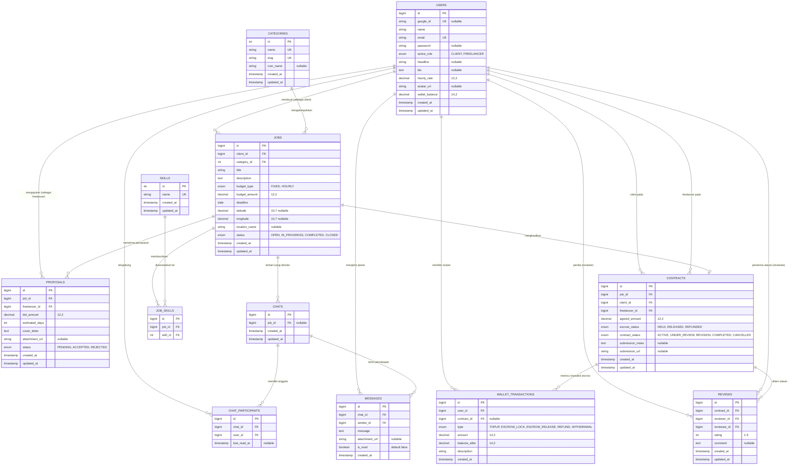

# Dokumentasi Arsitektur Backend Laravel 11, Skema ERD & Panduan Hosting Server
## Platform Marketplace GigSync (Upwork-Lite Android Native)

---

## 1. Pendahuluan & Ringkasan Arsitektur Backend

Backend **GigSync** dibangun menggunakan **Laravel 11.x (PHP 8.3+)** dengan basis data relasional **MySQL 8.0+**. Backend ini berfungsi sebagai *Single Source of Truth* (SSOT) dan peladen REST API terpusat untuk aplikasi Android native berbasis Kotlin Jetpack Compose.

### 1.1 Tech Stack Backend
| Komponen | Teknologi / Paket | Kegunaan Utama |
| :--- | :--- | :--- |
| **Framework** | Laravel 11.x | RESTful API Engine, Routing, Middleware, Database Migrations |
| **Runtime & Bahasa** | PHP 8.3+ FPM | Bahasa eksekusi backend modern dengan performa JIT & typing ketat |
| **Basis Data Relasional** | MySQL 8.0+ (InnoDB) | Penyimpanan data dengan jaminan integritas relasi (ACID & Foreign Keys) |
| **Autentikasi Token** | Laravel Sanctum 4.x | Stateful/Stateless Bearer API Token untuk otorisasi client Android |
| **Google Sign-In** | `google/apiclient:^2.15` | Verifikasi kriptografis Google ID Token JWT dari Android Credential Manager |
| **Manipulasi Berkas** | `intervention/image-laravel:^1.2` | Kompresi dan resize file unggahan avatar & bukti portofolio pelamar |
| **Real-time WebSockets** | Laravel Reverb / Pusher Protocol | Penanganan sistem chat instan & event broadcast notifikasi status lamaran |
| **Web Server & Reverse Proxy** | Nginx | Web server berkinerja tinggi, SSL termination, reverse proxy PHP-FPM & Reverb |
| **Process Manager** | Supervisor (Linux) | Daemon runner untuk background queue worker dan server WebSocket Reverb |

### 1.2 Standar Serialisasi JSON (CamelCase Compatibility)
> [!IMPORTANT]
> **Kritis untuk Integrasi Android:**
> Model Kotlin pada modul `:core:network` dan `:core:model` menggunakan format penamaan **`camelCase`** (contoh: `clientId`, `budgetType`, `budgetAmount`, `locationName`, `passwordConfirmation`) dan di-parse menggunakan `kotlinx.serialization` tanpa anotasi `@SerialName`.
> 
> Seluruh respons JSON backend **WAJIB** dibungkus oleh **Laravel API Resource (`JsonResource`)** yang mentransformasikan field basis data (`snake_case`) menjadi respons JSON berformat `camelCase`. Backend juga wajib menerima payload request baik dalam format `camelCase` maupun `snake_case`.

Format amplop standar respons JSON:
```json
{
  "success": true,
  "message": "Operasi berhasil dieksekusi",
  "data": { ... }
}
```

---

## 2. Entity Relationship Diagram (ERD) & Struktur Data

### 2.1 Diagram Relasi Entitas (Mermaid ERD)



### 2.2 Kamus Status (State Machine Lifecycle)

#### 1. Siklus Pekerjaan (`JobStatus`)
- `OPEN`: Lowongan aktif, dapat dicari, dan menerima proposal pelamar.
- `IN_PROGRESS`: Klien telah menerima proposal dan kontrak telah aktif.
- `COMPLETED`: Kontrak telah selesai dan dana telah dicairkan ke freelancer.
- `CLOSED`: Lowongan ditutup oleh klien tanpa memilih kandidat atau telah kedaluwarsa.

#### 2. Siklus Proposal (`ProposalStatus`)
- `PENDING`: Proposal berhasil diajukan dan sedang ditinjau oleh Klien.
- `ACCEPTED`: Klien menyetujui proposal $\rightarrow$ memicu pembuatan Kontrak & penguncian dana Escrow.
- `REJECTED`: Klien menolak proposal pelamar.

#### 3. Siklus Kontrak & Rekening Bersama (`ContractStatus` & `EscrowStatus`)
- `ACTIVE` & Escrow `HELD`: Kontrak berjalan, dana klien tersimpan aman di rekening penampungan sistem (*Held*).
- `UNDER_REVIEW` & Escrow `HELD`: Freelancer menyerahkan hasil kerja / link repositori / berkas.
- `REVISION` & Escrow `HELD`: Klien meminta perbaikan atas hasil kerja yang diserahkan.
- `COMPLETED` & Escrow `RELEASED`: Klien menyetujui hasil kerja $\rightarrow$ Dana escrow dipotong biaya platform (10%) dan masuk ke saldo aktif Freelancer.
- `CANCELLED` & Escrow `REFUNDED`: Pekerjaan dibatalkan $\rightarrow$ Dana escrow dikembalikan 100% ke saldo Klien.

---

## 3. Skema Database & Migrasi Lengkap (Laravel Migrations)

Berikut adalah berkas-berkas migrasi Laravel 11 dengan *foreign key constraints*, penanganan indeks, dan tipe data presisi.

### 3.1 Migrasi Tabel `users`
Berkas: `database/migrations/2026_01_01_000001_create_users_table.php`
```php
<?php

use Illuminate\Database\Migrations\Migration;
use Illuminate\Database\Schema\Blueprint;
use Illuminate\Support\Facades\Schema;

return new class extends Migration {
    public function up(): void {
        Schema::create('users', function (Blueprint $table) {
            $table->id();
            $table->string('google_id')->nullable()->unique();
            $table->string('name');
            $table->string('email')->unique();
            $table->string('password')->nullable();
            $table->enum('active_role', ['CLIENT', 'FREELANCER'])->default('FREELANCER');
            $table->string('headline')->nullable();
            $table->text('bio')->nullable();
            $table->decimal('hourly_rate', 12, 2)->default(0.00);
            $table->string('avatar_url', 500)->nullable();
            $table->decimal('wallet_balance', 14, 2)->default(0.00);
            $table->rememberToken();
            $table->timestamps();

            $table->index(['email', 'google_id']);
        });
    }

    public function down(): void {
        Schema::dropIfExists('users');
    }
};
```

### 3.2 Migrasi Tabel `categories`, `skills`, dan `job_skills`
Berkas: `database/migrations/2026_01_01_000002_create_categories_and_skills_tables.php`
```php
<?php

use Illuminate\Database\Migrations\Migration;
use Illuminate\Database\Schema\Blueprint;
use Illuminate\Support\Facades\Schema;

return new class extends Migration {
    public function up(): void {
        Schema::create('categories', function (Blueprint $table) {
            $table->increments('id');
            $table->string('name', 100)->unique();
            $table->string('slug', 100)->unique();
            $table->string('icon_name', 50)->nullable();
            $table->timestamps();
        });

        Schema::create('skills', function (Blueprint $table) {
            $table->increments('id');
            $table->string('name', 50)->unique();
            $table->timestamps();
        });
    }

    public function down(): void {
        Schema::dropIfExists('skills');
        Schema::dropIfExists('categories');
    }
};
```

### 3.3 Migrasi Tabel `jobs` (Dengan Koordinat Peta)
Berkas: `database/migrations/2026_01_01_000003_create_jobs_table.php`
```php
<?php

use Illuminate\Database\Migrations\Migration;
use Illuminate\Database\Schema\Blueprint;
use Illuminate\Support\Facades\Schema;

return new class extends Migration {
    public function up(): void {
        Schema::create('jobs', function (Blueprint $table) {
            $table->id();
            $table->foreignId('client_id')->constrained('users')->onDelete('cascade');
            $table->unsignedInteger('category_id');
            $table->foreign('category_id')->references('id')->on('categories')->onDelete('restrict');
            $table->string('title', 255);
            $table->text('description');
            $table->enum('budget_type', ['FIXED', 'HOURLY'])->default('FIXED');
            $table->decimal('budget_amount', 12, 2);
            $table->date('deadline');
            $table->decimal('latitude', 10, 7)->nullable();
            $table->decimal('longitude', 10, 7)->nullable();
            $table->string('location_name', 255)->nullable();
            $table->enum('status', ['OPEN', 'IN_PROGRESS', 'COMPLETED', 'CLOSED'])->default('OPEN');
            $table->timestamps();

            $table->index(['client_id', 'status']);
            $table->index(['category_id', 'status']);
            $table->index('deadline');
        });

        Schema::create('job_skills', function (Blueprint $table) {
            $table->id();
            $table->foreignId('job_id')->constrained('jobs')->onDelete('cascade');
            $table->unsignedInteger('skill_id');
            $table->foreign('skill_id')->references('id')->on('skills')->onDelete('cascade');
            $table->unique(['job_id', 'skill_id']);
        });
    }

    public function down(): void {
        Schema::dropIfExists('job_skills');
        Schema::dropIfExists('jobs');
    }
};
```

### 3.4 Migrasi Tabel `proposals` (Dengan Lampiran File)
Berkas: `database/migrations/2026_01_01_000004_create_proposals_table.php`
```php
<?php

use Illuminate\Database\Migrations\Migration;
use Illuminate\Database\Schema\Blueprint;
use Illuminate\Support\Facades\Schema;

return new class extends Migration {
    public function up(): void {
        Schema::create('proposals', function (Blueprint $table) {
            $table->id();
            $table->foreignId('job_id')->constrained('jobs')->onDelete('cascade');
            $table->foreignId('freelancer_id')->constrained('users')->onDelete('cascade');
            $table->decimal('bid_amount', 12, 2);
            $table->integer('estimated_days');
            $table->text('cover_letter');
            $table->string('attachment_url', 500)->nullable();
            $table->enum('status', ['PENDING', 'ACCEPTED', 'REJECTED'])->default('PENDING');
            $table->timestamps();

            $table->unique(['job_id', 'freelancer_id']);
            $table->index(['freelancer_id', 'status']);
        });
    }

    public function down(): void {
        Schema::dropIfExists('proposals');
    }
};
```

### 3.5 Migrasi Tabel `contracts`, `reviews`, dan `wallet_transactions`
Berkas: `database/migrations/2026_01_01_000005_create_contracts_and_transactions_tables.php`
```php
<?php

use Illuminate\Database\Migrations\Migration;
use Illuminate\Database\Schema\Blueprint;
use Illuminate\Support\Facades\Schema;

return new class extends Migration {
    public function up(): void {
        Schema::create('contracts', function (Blueprint $table) {
            $table->id();
            $table->foreignId('job_id')->constrained('jobs')->onDelete('restrict');
            $table->foreignId('client_id')->constrained('users')->onDelete('restrict');
            $table->foreignId('freelancer_id')->constrained('users')->onDelete('restrict');
            $table->decimal('agreed_amount', 12, 2);
            $table->enum('escrow_status', ['HELD', 'RELEASED', 'REFUNDED'])->default('HELD');
            $table->enum('contract_status', ['ACTIVE', 'UNDER_REVIEW', 'REVISION', 'COMPLETED', 'CANCELLED'])->default('ACTIVE');
            $table->text('submission_notes')->nullable();
            $table->string('submission_url', 500)->nullable();
            $table->timestamps();

            $table->index(['client_id', 'contract_status']);
            $table->index(['freelancer_id', 'contract_status']);
        });

        Schema::create('reviews', function (Blueprint $table) {
            $table->id();
            $table->foreignId('contract_id')->constrained('contracts')->onDelete('cascade');
            $table->foreignId('reviewer_id')->constrained('users')->onDelete('cascade');
            $table->foreignId('reviewee_id')->constrained('users')->onDelete('cascade');
            $table->tinyInteger('rating')->unsigned();
            $table->text('comment')->nullable();
            $table->timestamps();

            $table->unique(['contract_id', 'reviewer_id']);
        });

        Schema::create('wallet_transactions', function (Blueprint $table) {
            $table->id();
            $table->foreignId('user_id')->constrained('users')->onDelete('cascade');
            $table->foreignId('contract_id')->nullable()->constrained('contracts')->onDelete('set null');
            $table->enum('type', ['TOPUP', 'ESCROW_LOCK', 'ESCROW_RELEASE', 'REFUND', 'WITHDRAWAL']);
            $table->decimal('amount', 14, 2);
            $table->decimal('balance_after', 14, 2);
            $table->string('description', 255);
            $table->timestamp('created_at')->useCurrent();

            $table->index(['user_id', 'type']);
        });
    }

    public function down(): void {
        Schema::dropIfExists('wallet_transactions');
        Schema::dropIfExists('reviews');
        Schema::dropIfExists('contracts');
    }
};
```

### 3.6 Migrasi Tabel `chats` dan `messages` (Real-time Chat)
Berkas: `database/migrations/2026_01_01_000006_create_chat_tables.php`
```php
<?php

use Illuminate\Database\Migrations\Migration;
use Illuminate\Database\Schema\Blueprint;
use Illuminate\Support\Facades\Schema;

return new class extends Migration {
    public function up(): void {
        Schema::create('chats', function (Blueprint $table) {
            $table->id();
            $table->foreignId('job_id')->nullable()->constrained('jobs')->onDelete('set null');
            $table->timestamps();
        });

        Schema::create('chat_participants', function (Blueprint $table) {
            $table->id();
            $table->foreignId('chat_id')->constrained('chats')->onDelete('cascade');
            $table->foreignId('user_id')->constrained('users')->onDelete('cascade');
            $table->timestamp('last_read_at')->nullable();
            $table->unique(['chat_id', 'user_id']);
        });

        Schema::create('messages', function (Blueprint $table) {
            $table->id();
            $table->foreignId('chat_id')->constrained('chats')->onDelete('cascade');
            $table->foreignId('sender_id')->constrained('users')->onDelete('cascade');
            $table->text('message');
            $table->string('attachment_url', 500)->nullable();
            $table->boolean('is_read')->default(false);
            $table->timestamp('created_at')->useCurrent();

            $table->index(['chat_id', 'created_at']);
        });
    }

    public function down(): void {
        Schema::dropIfExists('messages');
        Schema::dropIfExists('chat_participants');
    }
};
```

---

## 4. Spesifikasi Kontrak REST API v1 (Lengkap)

Semua endpoint berawalan prefix: `/api/v1`

### 4.1 Modul Autentikasi (`/auth`)

#### 1. Register Akun Konvensional
- **Endpoint:** `POST /api/v1/auth/register`
- **Headers:** `Accept: application/json`, `Content-Type: application/json`
- **Request Body:**
  ```json
  {
    "name": "Zhafran Mufadhdhol",
    "email": "zhafran@telkomuniversity.ac.id",
    "password": "Password123!",
    "passwordConfirmation": "Password123!"
  }
  ```
- **Response 201 Created:**
  ```json
  {
    "success": true,
    "message": "Registrasi akun berhasil",
    "data": {
      "token": "1|qX8zP19w84UeM1kL...",
      "user": {
        "id": 1,
        "googleId": null,
        "name": "Zhafran Mufadhdhol",
        "email": "zhafran@telkomuniversity.ac.id",
        "activeRole": "FREELANCER",
        "headline": null,
        "bio": null,
        "hourlyRate": 0.0,
        "avatarUrl": null,
        "walletBalance": 0.0
      }
    }
  }
  ```

#### 2. Login Akun Konvensional
- **Endpoint:** `POST /api/v1/auth/login`
- **Request Body:**
  ```json
  {
    "email": "zhafran@telkomuniversity.ac.id",
    "password": "Password123!"
  }
  ```
- **Response 200 OK:** Format persis sama dengan respons Register.

#### 3. Google Sign-In Exchange (Credential Manager)
- **Endpoint:** `POST /api/v1/auth/google`
- **Request Body:**
  ```json
  {
    "idToken": "eyJhbGciOiJSUzI1NiIsImtpZCI6IjE..."
  }
  ```
- **Response 200 OK:**
  ```json
  {
    "success": true,
    "message": "Autentikasi Google berhasil",
    "data": {
      "token": "2|x8kLpM901VwP...",
      "user": {
        "id": 1,
        "googleId": "109823471029384",
        "name": "Zhafran Mufadhdhol",
        "email": "zhafran@gmail.com",
        "activeRole": "FREELANCER",
        "headline": "Android & Cloud Architect",
        "bio": "Mahasiswa D3 Rekayasa Perangkat Lunak Aplikasi",
        "hourlyRate": 150000.0,
        "avatarUrl": "https://lh3.googleusercontent.com/a/...",
        "walletBalance": 500000.0
      }
    }
  }
  ```

#### 4. Switch Peran Pengguna Aktif (Dual-Role Toggle)
- **Endpoint:** `PUT /api/v1/users/active-role`
- **Headers:** `Authorization: Bearer <token>`
- **Request Body:**
  ```json
  {
    "activeRole": "CLIENT"
  }
  ```
- **Response 200 OK:** Mengembalikan objek user terbaru dengan `activeRole: "CLIENT"`.

---

### 4.2 Modul Lowongan Kerja (`/jobs`)

#### 1. Jelajah Lowongan Feed (Freelancer SCR-06)
- **Endpoint:** `GET /api/v1/jobs?search={keyword}&category_id={id}`
- **Headers:** `Authorization: Bearer <token>`
- **Response 200 OK:**
  ```json
  {
    "success": true,
    "message": "Daftar lowongan pekerjaan berhasil diambil",
    "data": [
      {
        "id": 101,
        "clientId": 2,
        "clientName": "PT Inovasi Digital",
        "clientAvatarUrl": "https://api.gigsync.com/storage/avatars/client1.jpg",
        "title": "Pengembangan Modul Android Compose",
        "description": "Dibutuhkan freelancer untuk menyusun antarmuka Jetpack Compose...",
        "categoryId": 1,
        "categoryName": "Mobile Development",
        "budgetType": "FIXED",
        "budgetAmount": 3500000.0,
        "deadline": "2026-11-30",
        "latitude": -6.9740279,
        "longitude": 107.6303481,
        "locationName": "Telkom University, Bandung",
        "skills": ["Android", "Kotlin", "Jetpack Compose", "Hilt"],
        "status": "OPEN",
        "proposalsCount": 4,
        "createdAt": "2026-10-10T14:00:00Z"
      }
    ]
  }
  ```

#### 2. Detail Lowongan Kerja (SCR-08)
- **Endpoint:** `GET /api/v1/jobs/{id}`
- **Response 200 OK:** Mengembalikan objek tunggal `Job` lengkap.

#### 3. Pasang Lowongan Baru (Klien SCR-13 s/d SCR-15)
- **Endpoint:** `POST /api/v1/jobs`
- **Headers:** `Authorization: Bearer <token>`
- **Request Body:**
  ```json
  {
    "title": "Aplikasi Presensi GPS Mahasiswa",
    "description": "Membangun sistem presensi berbasis geofencing kampus...",
    "categoryId": 1,
    "budgetType": "FIXED",
    "budgetAmount": 2500000.0,
    "deadline": "2026-12-15",
    "latitude": -6.9730000,
    "longitude": 107.6300000,
    "locationName": "Gedung Selaru, Telkom University",
    "skills": ["Android", "Kotlin", "Room Database"]
  }
  ```
- **Response 201 Created:** Mengembalikan data pekerjaan yang baru saja dibuat.

#### 4. Dashboard Lowongan Klien (SCR-12)
- **Endpoint:** `GET /api/v1/client/jobs`
- **Headers:** `Authorization: Bearer <token>`
- **Response 200 OK:** Mengembalikan seluruh lowongan milik klien yang sedang login beserta jumlah pelamar yang masuk.

---

### 4.3 Modul Proposal & Pelamar (`/proposals`)

#### 1. Kirim Proposal & Unggah Bukti Portofolio (Freelancer SCR-09)
- **Endpoint:** `POST /api/v1/jobs/{jobId}/proposals`
- **Headers:** `Authorization: Bearer <token>`, `Content-Type: multipart/form-data`
- **Form Data (Multipart):**
  - `bidAmount`: `3000000` (float)
  - `estimatedDays`: `14` (integer)
  - `coverLetter`: `Halo, saya telah berpengalaman 2 tahun membuat aplikasi Android Compose...`
  - `attachment`: *[File binary: .jpg / .png / .pdf maks 5MB]*
- **Response 201 Created:**
  ```json
  {
    "success": true,
    "message": "Proposal penawaran berhasil diajukan",
    "data": {
      "id": 55,
      "jobId": 101,
      "jobTitle": "Pengembangan Modul Android Compose",
      "freelancerId": 1,
      "freelancerName": "Zhafran Mufadhdhol",
      "freelancerAvatarUrl": "https://api.gigsync.com/storage/avatars/user1.jpg",
      "freelancerHeadline": "Android & Cloud Architect",
      "bidAmount": 3000000.0,
      "estimatedDays": 14,
      "coverLetter": "Halo, saya telah berpengalaman 2 tahun membuat...",
      "attachmentUrl": "https://api.gigsync.com/storage/proposals/portfolio_55.jpg",
      "status": "PENDING",
      "createdAt": "2026-10-10T14:30:00Z"
    }
  }
  ```

#### 2. Daftar Proposal Pelamar untuk Suatu Pekerjaan (Klien SCR-16)
- **Endpoint:** `GET /api/v1/jobs/{jobId}/proposals`
- **Headers:** `Authorization: Bearer <token>`
- **Response 200 OK:** Mengembalikan `List<Proposal>` yang masuk untuk lowongan tersebut.

#### 3. Update Status Proposal (Terima / Tolak Klien SCR-17)
- **Endpoint:** `PUT /api/v1/proposals/{id}/status`
- **Headers:** `Authorization: Bearer <token>`
- **Request Body:**
  ```json
  {
    "status": "ACCEPTED"
  }
  ```
- **Catatan Logika Bisnis:**
  - Jika `ACCEPTED`: Sistem mengecek apakah saldo klien mencukupi. Jika cukup, sistem otomatis mengunci dana escrow, mengubah status proposal menjadi `ACCEPTED`, dan membuat entitas `Contract` baru berstatus `ACTIVE`.
  - Jika `REJECTED`: Status proposal berubah menjadi `REJECTED`.
  - Memancarkan event WebSocket/Push Notification ke perangkat Android Freelancer.

---

### 4.4 Modul Kontrak & Rekening Bersama (Mock Escrow `/contracts`)

#### 1. Unified Contract Detail (SCR-20)
- **Endpoint:** `GET /api/v1/contracts/{id}`
- **Headers:** `Authorization: Bearer <token>`
- **Response 200 OK:**
  ```json
  {
    "success": true,
    "message": "Detail kontrak berhasil diambil",
    "data": {
      "id": 12,
      "jobId": 101,
      "jobTitle": "Pengembangan Modul Android Compose",
      "clientId": 2,
      "clientName": "PT Inovasi Digital",
      "freelancerId": 1,
      "freelancerName": "Zhafran Mufadhdhol",
      "agreedAmount": 3000000.0,
      "escrowStatus": "HELD",
      "contractStatus": "ACTIVE",
      "submissionNotes": null,
      "submissionUrl": null,
      "createdAt": "2026-10-10T15:00:00Z"
    }
  }
  ```

#### 2. Penyerahan Hasil Kerja oleh Freelancer (SCR-21)
- **Endpoint:** `POST /api/v1/contracts/{id}/submit`
- **Headers:** `Authorization: Bearer <token>`
- **Request Body:**
  ```json
  {
    "submissionNotes": "Pekerjaan modul Android telah selesai sesuai PRD, repositori terlampir.",
    "submissionUrl": "https://github.com/D3IF-Cool/tubes-48gab1-app-freelancer"
  }
  ```
- **Response 200 OK:** Mengubah `contractStatus` menjadi `UNDER_REVIEW`.

#### 3. Persetujuan Pekerjaan & Rilis Dana Escrow oleh Klien (SCR-22)
- **Endpoint:** `POST /api/v1/contracts/{id}/approve`
- **Headers:** `Authorization: Bearer <token>`
- **Response 200 OK:**
  - Mengubah `contractStatus` menjadi `COMPLETED`.
  - Mengubah `escrowStatus` menjadi `RELEASED`.
  - Mentransfer dana `agreedAmount` dikurangi platform fee (10%) ke saldo aktif `wallet_balance` milik Freelancer.

#### 4. Permintaan Revisi Hasil Kerja (SCR-22)
- **Endpoint:** `POST /api/v1/contracts/{id}/revise`
- **Request Body:**
  ```json
  {
    "revisionNotes": "Mohon perbaiki bug crash pada layar SCR-08 di resolusi tablet."
  }
  ```
- **Response 200 OK:** Mengubah `contractStatus` menjadi `REVISION`.

---

### 4.5 Modul Ulasan & Rating (`/reviews`)
- **Endpoint:** `POST /api/v1/contracts/{id}/reviews`
- **Request Body:**
  ```json
  {
    "rating": 5,
    "comment": "Pekerjaan sangat rapi, arsitektur multi-module terstruktur dengan baik!"
  }
  ```
- **Response 201 Created:** Mengembalikan entitas `Review`.

---

## 5. Implementasi Logika Bisnis Kritis (Core Logic)

### 5.1 Verifikasi Google ID Token Kriptografis
Berkas: `app/Services/GoogleAuthService.php`

```php
<?php

namespace App\Services;

use Google_Client;
use App\Models\User;
use Illuminate\Support\Str;
use Illuminate\Validation\ValidationException;

class GoogleAuthService
{
    private Google_Client $client;

    public function __construct()
    {
        $this->client = new Google_Client(['client_id' => config('services.google.client_id')]);
    }

    public function authenticate(string $idToken): array
    {
        // 1. Verifikasi tanda tangan kriptografis token via public key Google
        $payload = $this->client->verifyIdToken($idToken);

        if (!$payload) {
            throw ValidationException::withMessages([
                'idToken' => ['Google ID Token tidak valid atau telah kedaluwarsa.']
            ]);
        }

        $googleId = $payload['sub'];
        $email = $payload['email'];
        $name = $payload['name'] ?? 'Google User';
        $picture = $payload['picture'] ?? null;

        // 2. Temukan pengguna berdasarkan google_id atau email
        $user = User::where('google_id', $googleId)
            ->orWhere('email', $email)
            ->first();

        if ($user) {
            if (!$user->google_id) {
                $user->google_id = $googleId;
            }
            if (!$user->avatar_url && $picture) {
                $user->avatar_url = $picture;
            }
            $user->save();
        } else {
            // Buat pengguna baru jika belum terdaftar
            $user = User::create([
                'google_id' => $googleId,
                'name' => $name,
                'email' => $email,
                'password' => bcrypt(Str::random(32)),
                'avatar_url' => $picture,
                'active_role' => 'FREELANCER',
                'wallet_balance' => 0.00
            ]);
        }

        // 3. Terbitkan token Sanctum
        $token = $user->createToken('android-device')->plainTextToken;

        return [
            'token' => $token,
            'user' => $user
        ];
    }
}
```

### 5.2 Logika Mock Escrow dengan Transaksi ACID & Pessimistic Locking
Berkas: `app/Services/EscrowService.php`

```php
<?php

namespace App\Services;

use App\Models\Contract;
use App\Models\Proposal;
use App\Models\User;
use App\Models\WalletTransaction;
use Illuminate\Support\Facades\DB;
use Symfony\Component\HttpKernel\Exception\HttpException;

class EscrowService
{
    /**
     * Menerima proposal & mengunci dana escrow Klien ke penampungan
     */
    public function acceptProposalAndHoldEscrow(Proposal $proposal, User $client): Contract
    {
        return DB::transaction(function () use ($proposal, $client) {
            // 1. Lock baris akun klien secara pesimistik agar saldo tidak bisa dipakai ganda (double-spent)
            $lockedClient = User::where('id', $client->id)->lockForUpdate()->first();

            $agreedAmount = $proposal->bid_amount;

            if ($lockedClient->wallet_balance < $agreedAmount) {
                throw new HttpException(400, 'Saldo dompet tidak mencukupi untuk mendepositkan dana escrow.');
            }

            // 2. Kurangi saldo aktif klien
            $lockedClient->wallet_balance -= $agreedAmount;
            $lockedClient->save();

            // 3. Ubah status proposal
            $proposal->update(['status' => 'ACCEPTED']);

            // 4. Buat kontrak baru
            $contract = Contract::create([
                'job_id' => $proposal->job_id,
                'client_id' => $lockedClient->id,
                'freelancer_id' => $proposal->freelancer_id,
                'agreed_amount' => $agreedAmount,
                'escrow_status' => 'HELD',
                'contract_status' => 'ACTIVE'
            ]);

            // 5. Catat mutasi penahanan saldo
            WalletTransaction::create([
                'user_id' => $lockedClient->id,
                'contract_id' => $contract->id,
                'type' => 'ESCROW_LOCK',
                'amount' => -$agreedAmount,
                'balance_after' => $lockedClient->wallet_balance,
                'description' => "Penguncian dana escrow untuk kontrak #{$contract->id}"
            ]);

            // 6. Update status pekerjaan menjadi IN_PROGRESS
            $proposal->job->update(['status' => 'IN_PROGRESS']);

            return $contract;
        });
    }

    /**
     * Menyetujui hasil kerja & mencairkan dana escrow ke Freelancer (Potong Platform Fee 10%)
     */
    public function releaseEscrowToFreelancer(Contract $contract): void
    {
        DB::transaction(function () use ($contract) {
            $lockedFreelancer = User::where('id', $contract->freelancer_id)->lockForUpdate()->first();

            $platformFee = $contract->agreed_amount * 0.10; // Potongan 10%
            $netEarnings = $contract->agreed_amount - $platformFee;

            // Tambah saldo aktif freelancer
            $lockedFreelancer->wallet_balance += $netEarnings;
            $lockedFreelancer->save();

            // Ubah status kontrak & escrow
            $contract->update([
                'escrow_status' => 'RELEASED',
                'contract_status' => 'COMPLETED'
            ]);

            // Catat mutasi pencairan saldo
            WalletTransaction::create([
                'user_id' => $lockedFreelancer->id,
                'contract_id' => $contract->id,
                'type' => 'ESCROW_RELEASE',
                'amount' => $netEarnings,
                'balance_after' => $lockedFreelancer->wallet_balance,
                'description' => "Pencairan hasil kerja kontrak #{$contract->id} (Fee platform 10%)"
            ]);

            // Ubah status pekerjaan menjadi COMPLETED
            $contract->job->update(['status' => 'COMPLETED']);
        });
    }
}
```

### 5.3 Transformasi Respon CamelCase (API Resources)
Berkas: `app/Http/Resources/JobResource.php`

```php
<?php

namespace App\Http\Resources;

use Illuminate\Http\Request;
use Illuminate\Http\Resources\Json\JsonResource;

class JobResource extends JsonResource
{
    public function toArray(Request $request): array
    {
        return [
            'id' => $this->id,
            'clientId' => $this->client_id,
            'clientName' => $this->client?->name,
            'clientAvatarUrl' => $this->client?->avatar_url,
            'title' => $this->title,
            'description' => $this->description,
            'categoryId' => $this->category_id,
            'categoryName' => $this->category?->name,
            'budgetType' => $this->budget_type,
            'budgetAmount' => (float) $this->budget_amount,
            'deadline' => $this->deadline->format('Y-m-d'),
            'latitude' => $this->latitude ? (float) $this->latitude : null,
            'longitude' => $this->longitude ? (float) $this->longitude : null,
            'locationName' => $this->location_name,
            'skills' => $this->skills->pluck('name')->toArray(),
            'status' => $this->status,
            'proposalsCount' => $this->proposals()->count(),
            'createdAt' => $this->created_at?->toISOString()
        ];
    }
}
```

---

## 6. Data Seeder Siap Pakai (DatabaseSeeder.php)

Untuk mempercepat pengujian aplikasi Android (Riza, Maikel, dan Zhafran), gunakan seeder komprehensif berikut dengan data khas Telkom University.

Berkas: `database/seeders/DatabaseSeeder.php`
```php
<?php

namespace Database\Seeders;

use Illuminate\Database\Seeder;
use App\Models\User;
use App\Models\Category;
use App\Models\Skill;
use App\Models\Job;
use Illuminate\Support\Facades\Hash;

class DatabaseSeeder extends Seeder
{
    public function run(): void
    {
        // 1. Kategori
        $categories = [
            ['name' => 'Mobile Development', 'slug' => 'mobile-dev', 'icon_name' => 'phone_android'],
            ['name' => 'Web Development', 'slug' => 'web-dev', 'icon_name' => 'language'],
            ['name' => 'UI/UX Design', 'slug' => 'ui-ux', 'icon_name' => 'palette'],
            ['name' => 'Machine Learning & AI', 'slug' => 'ai-ml', 'icon_name' => 'memory'],
            ['name' => 'Content & Copywriting', 'slug' => 'writing', 'icon_name' => 'edit'],
        ];
        foreach ($categories as $cat) {
            Category::firstOrCreate(['slug' => $cat['slug']], $cat);
        }

        // 2. Skill Tags
        $skills = ['Android', 'Kotlin', 'Jetpack Compose', 'Laravel', 'Flutter', 'Figma', 'MySQL', 'Python', 'React'];
        foreach ($skills as $skill) {
            Skill::firstOrCreate(['name' => $skill]);
        }

        // 3. User Demo Klien & Freelancer
        $client = User::firstOrCreate(['email' => 'client@gigsync.com'], [
            'name' => 'PT Telkom Digital Solusindo',
            'password' => Hash::make('Password123!'),
            'active_role' => 'CLIENT',
            'headline' => 'Enterprise Mobile Client',
            'bio' => 'Perusahaan inkubator produk digital kampus.',
            'wallet_balance' => 20000000.00,
            'avatar_url' => 'https://images.unsplash.com/photo-1534528741775-53994a69daeb?w=400'
        ]);

        $freelancer = User::firstOrCreate(['email' => 'freelancer@gigsync.com'], [
            'name' => 'Zhafran Mufadhdhol',
            'password' => Hash::make('Password123!'),
            'active_role' => 'FREELANCER',
            'headline' => 'Senior Native Android & Cloud Engineer',
            'bio' => 'Mahasiswa tingkat akhir Telkom University dengan keahlian Kotlin Multiplatform.',
            'hourly_rate' => 175000.00,
            'wallet_balance' => 1500000.00,
            'avatar_url' => 'https://images.unsplash.com/photo-1507003211169-0a1dd7228f2d?w=400'
        ]);

        // 4. Job Dummy
        $catMobile = Category::where('slug', 'mobile-dev')->first();
        $job = Job::firstOrCreate(['title' => 'Pengembangan Fitur Peta Android GigSync'], [
            'client_id' => $client->id,
            'category_id' => $catMobile->id,
            'description' => 'Membangun integrasi Google Maps/OSM pada modul Post Job sesuai rubrik praktikum.',
            'budget_type' => 'FIXED',
            'budget_amount' => 4500000.00,
            'deadline' => now()->addDays(20)->toDateString(),
            'latitude' => -6.9740279,
            'longitude' => 107.6303481,
            'location_name' => 'Telkom University Landmark Tower (TULT)',
            'status' => 'OPEN'
        ]);

        $job->skills()->sync([1, 2, 3]); // Android, Kotlin, Compose
    }
}
```

---

## 7. Panduan Setup Lokal (Local Development)

### 7.1 Langkah Instalasi Pertama Kali
Jalankan urutan perintah berikut di root folder project backend:

```bash
# 1. Install seluruh dependensi PHP
composer install

# 2. Salin environment file
cp .env.example .env

# 3. Generate Laravel Application Key
php artisan key:generate

# 4. Buat symbolic link direktori berkas publik
php artisan storage:link

# 5. Jalankan migrasi dan seeder awal
php artisan migrate:fresh --seed
```

### 7.2 Menghubungkan Android Emulator ke Localhost
Saat menjalankan aplikasi di Android Studio Emulator:
- Gunakan alamat IP virtual Android Emulator: `http://10.0.2.2:8000/`
- Jalankan server Laravel dengan mengikat ke semua IP antarmuka lokal:
  ```bash
  php artisan serve --host=0.0.0.0 --port=8000
  ```

---

## 8. Panduan Lengkap Hosting & Deployment Server Produksi (Ubuntu VPS)

Panduan ini disusun untuk deployment pada VPS (Ubuntu 22.04 / 24.04 LTS) seperti **DigitalOcean, Linode, AWS EC2, IDCloudHost, atau Niagahoster Cloud**.

### 8.1 Persiapan Sistem & Instalasi Paket Server
Jalankan di terminal server VPS melalui SSH:

```bash
# Update repository sistem
sudo apt update && sudo apt upgrade -y

# Tambahkan PPA PHP 8.3 resmi Ondrej
sudo apt install -y software-properties-common curl git unzip ufw
sudo add-apt-repository ppa:ondrej/php -y
sudo apt update

# Install Nginx, MySQL Server, dan ekstensi PHP 8.3
sudo apt install -y nginx mysql-server \
    php8.3-fpm php8.3-cli php8.3-mysql php8.3-curl php8.3-gd \
    php8.3-mbstring php8.3-xml php8.3-zip php8.3-bcmath php8.3-intl

# Install Composer global
curl -sS https://getcomposer.org/installer | php
sudo mv composer.phar /usr/local/bin/composer
```

### 8.2 Konfigurasi Database MySQL di Server
```bash
sudo mysql
```
Jalankan query SQL berikut di dalam prompt MySQL:
```sql
CREATE DATABASE gigsync_db CHARACTER SET utf8mb4 COLLATE utf8mb4_unicode_ci;
CREATE USER 'gigsync_user'@'localhost' IDENTIFIED BY 'StrongDatabasePassword2026!';
GRANT ALL PRIVILEGES ON gigsync_db.* TO 'gigsync_user'@'localhost';
FLUSH PRIVILEGES;
EXIT;
```

### 8.3 Menyiapkan Folder Proyek & Hak Akses Direktori
```bash
# Buat folder proyek web
sudo mkdir -p /var/www/gigsync-backend
sudo chown -R $USER:www-data /var/www/gigsync-backend

# Clone repositori backend
git clone https://github.com/mzhafraaan/gigsync-backend.git /var/www/gigsync-backend
cd /var/www/gigsync-backend

# Install dependensi tanpa package dev untuk efisiensi RAM server
composer install --no-dev --optimize-autoloader

# Atur berkas .env untuk mode produksi
cp .env.example .env
nano .env
```

Sesuaikan baris penting di `.env`:
```env
APP_NAME=GigSync
APP_ENV=production
APP_KEY=base64:... # generate via php artisan key:generate
APP_DEBUG=false
APP_URL=https://api.gigsync.my.id

DB_CONNECTION=mysql
DB_HOST=127.0.0.1
DB_PORT=3306
DB_DATABASE=gigsync_db
DB_USERNAME=gigsync_user
DB_PASSWORD=StrongDatabasePassword2026!

# Kredensial Google OAuth Credential Manager
GOOGLE_CLIENT_ID=xxxxxxxx.apps.googleusercontent.com
```

Jalankan perintah final di direktori proyek:
```bash
php artisan key:generate
php artisan storage:link
php artisan migrate --force --seed
php artisan config:cache
php artisan route:cache
php artisan view:cache

# Berikan hak akses tulis direktori storage & bootstrap cache ke www-data
sudo chown -R www-data:www-data /var/www/gigsync-backend/storage /var/www/gigsync-backend/bootstrap/cache
sudo chmod -R 775 /var/www/gigsync-backend/storage /var/www/gigsync-backend/bootstrap/cache
```

### 8.4 Konfigurasi Web Server Nginx
Buat konfigurasi virtual host baru:
```bash
sudo nano /etc/nginx/sites-available/gigsync.conf
```

Tempelkan konfigurasi berikut:
```nginx
server {
    listen 80;
    server_name api.gigsync.my.id; # Ganti dengan domain/subdomain Anda

    root /var/www/gigsync-backend/public;
    index index.php index.html;

    client_max_body_size 20M;

    location / {
        try_files $uri $uri/ /index.php?$query_string;
    }

    location ~ \.php$ {
        include snippets/fastcgi-php.conf;
        fastcgi_pass unix:/var/run/php/php8.3-fpm.sock;
        fastcgi_param SCRIPT_FILENAME $realpath_root$fastcgi_script_name;
        include fastcgi_params;
    }

    location ~ /\.(?!well-known).* {
        deny all;
    }
}
```

Aktifkan konfigurasi dan restart Nginx:
```bash
sudo ln -s /etc/nginx/sites-available/gigsync.conf /etc/nginx/sites-enabled/
sudo nginx -t
sudo systemctl reload nginx
```

### 8.5 Pemasangan Sertifikat SSL Gratis (Let's Encrypt / HTTPS)
Aplikasi Android (Android 9+ / Pie) secara default memblokir lalu lintas *cleartext HTTP*. Oleh karena itu, HTTPS adalah syarat mutlak!

```bash
sudo apt install -y certbot python3-certbot-nginx
sudo certbot --nginx -d api.gigsync.my.id
```
Pilih opsi *Redirect HTTP to HTTPS* otomatis.

### 8.6 Pengaturan CORS (`config/cors.php`)
Pastikan Laravel mengizinkan header Android Retrofit:
```php
return [
    'paths' => ['api/*', 'sanctum/csrf-cookie'],
    'allowed_methods' => ['*'],
    'allowed_origins' => ['*'],
    'allowed_headers' => ['*'],
    'exposed_headers' => [],
    'max_age' => 0,
    'supports_credentials' => false,
];
```

### 8.7 Konfigurasi Process Manager (Supervisor untuk Queue & WebSocket)
Jika menggunakan Laravel Reverb / WebSockets untuk notifikasi chat real-time, buat berkas Supervisor:
```bash
sudo apt install -y supervisor
sudo nano /etc/supervisor/conf.d/gigsync-worker.conf
```

Isi konfigurasi:
```ini
[program:gigsync-queue]
process_name=%(program_name)s_%(process_num)02d
command=php /var/www/gigsync-backend/artisan queue:work --sleep=3 --tries=3 --max-time=3600
autostart=true
autorestart=true
stopasgroup=true
killasgroup=true
user=www-data
numprocs=1
redirect_stderr=true
stdout_logfile=/var/www/gigsync-backend/storage/logs/queue.log
```

Muat ulang Supervisor:
```bash
sudo supervisorctl reread
sudo supervisorctl update
sudo supervisorctl start gigsync-queue:*
```

### 8.8 Script Deployment Otomatis (`deploy.sh`)
Simpan script ini di `/var/www/gigsync-backend/deploy.sh` agar setiap ada pembaharuan kode di Git, pembaruan di server dapat dieksekusi dengan satu perintah:

```bash
#!/bin/bash
set -e

echo "Deploying update to production..."
git pull origin main
composer install --no-dev --optimize-autoloader
php artisan migrate --force
php artisan config:cache
php artisan route:cache
php artisan view:cache
sudo systemctl reload php8.3-fpm
sudo supervisorctl restart gigsync-queue:*
echo "Deployment completed successfully!"
```

Jadikan berkas executable:
```bash
chmod +x /var/www/gigsync-backend/deploy.sh
```

---

## 9. Sinkronisasi dengan Aplikasi Android Native

Ubah konfigurasi base URL di Android `RetrofitClient.kt` saat beralih dari lokal ke server publik:

```kotlin
// Lokasi: core/network/src/main/java/com/d3ifcool/freelanceos/core/network/RetrofitClient.kt

object RetrofitClient {
    // Development Lokal Emulator:
    // private const val DEFAULT_BASE_URL = "http://10.0.2.2:8000/"

    // Production Server Hosting:
    private const val DEFAULT_BASE_URL = "https://api.gigsync.my.id/"
    ...
}
```

Dengan seluruh arsitektur, skema relasional, dan spesifikasi API di atas, backend Laravel siap dibangun secara modular, aman, dan langsung kompatibel 100% dengan tim Android (Riza dan Maikel).
